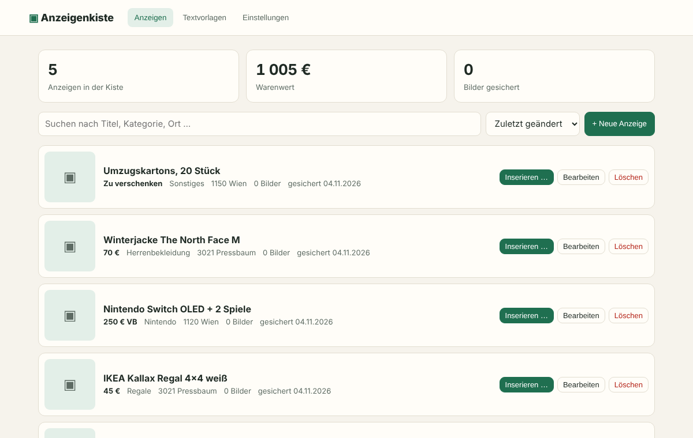

# Anzeigenkiste

Freie Browsererweiterung für alle, die auf Kleinanzeigen verkaufen. Anzeigen sichern, neu inserieren, Textvorlagen im Postfach nutzen und Anzeigen zwischen Kleinanzeigen, Vinted, eBay, willhaben, Facebook Marketplace, markt.de und Quoka übertragen.

**Open Source (MIT) · ohne Konto · ohne Abo · alle Daten bleiben lokal im Browser**



## Funktionen

| Funktion | Wo | Was passiert |
|---|---|---|
| Anzeige sichern | jede Anzeige (`/s-anzeige/…`) | Knopf „In Anzeigenkiste speichern“ sichert Titel, Text, Preis, Kategorie, Merkmale und Bilder |
| Alle sichern | „Meine Anzeigen“ | Panel sichert alle sichtbaren Anzeigen nacheinander (bewusst gedrosselt) |
| Inserieren | Dashboard → „Inserieren …“ | Plattformen ankreuzen (Kleinanzeigen, Vinted, eBay, willhaben, Facebook, markt.de, Quoka). Je Plattform öffnet sich ein Tab, das Formular wird mit Titel, Text, Preis und Bildern ausgefüllt. Kopier-Knöpfe als Rückfall |
| Vinted als Vorlage | Artikel von Vinted holen, dann „Inserieren …“ | Kategorie, Marke, Größe, Zustand und Farbe werden von Vinted übernommen und auf Kleinanzeigen und willhaben automatisch gesetzt – auch Felder, die erst nach der Kategoriewahl erscheinen |
| Gegenrichtung | Artikelseiten auf Vinted, eBay, willhaben | Knopf „In Anzeigenkiste speichern“ liest den Artikel aus (JSON-LD, sonst Open Graph) |
| Direkt kaufen | Dashboard → Einstellungen → Kleinanzeigen | „Direkt kaufen“ automatisch auf Ja (inkl. „Versand möglich“) oder Nein setzen, oder selbst wählen |
| Textvorlagen | Postfach (`/m-nachrichten…`) | Vorlagen-Chips über dem Nachrichtenfeld, Klick fügt Text ein |
| Übersicht | Dashboard | Liste mit Preis, Ort, Schlagwörtern; Suche, Sortierung, Bearbeiten, eigene Anzeigen anlegen |
| Sicherung | Dashboard → Einstellungen | Export/Import der ganzen Kiste als JSON |

**Bewusst nicht enthalten:** automatisches Verlängern, automatisches Veröffentlichen, Autoresponder. Kleinanzeigen untersagt automatisierte Zugriffe in seinen Nutzungsbedingungen. Anzeigenkiste füllt nur aus, abschicken tut immer der Mensch.

## Installieren (Entwicklerversion)

```bash
npm install
npm run build        # erzeugt dist/chrome, dist/firefox und je ein .zip
```

- **Chrome / Edge / Brave:** `chrome://extensions` → Entwicklermodus → „Entpackte Erweiterung laden“ → `dist/chrome`
- **Firefox (≥ 121):** `about:debugging#/runtime/this-firefox` → „Temporäres Add-on laden“ → `dist/firefox/manifest.json`

## Projektstruktur

```
src/
  manifest.json          Manifest V3 (Chrome); build.mjs erzeugt die Firefox-Variante
  background.js          lädt Bilder, öffnet Tabs
  lib/
    api.js               chrome/browser-Shim
    storage.js           Anzeigen, Vorlagen, offene Aktionen (storage.local)
    dom.js               Felder befüllen (React-sicher), Dateien einfügen, Panel, Toasts
    selectors.js         ALLE Kleinanzeigen-Selektoren an einer Stelle
    parse.js             liest eine Kleinanzeigen-Detailseite aus
    platforms.js         Zielplattformen: Startseite, Formularfelder, Artikelseiten
    mapping.js           Vinted-Kategorie/-Merkmale → Kleinanzeigen-Kategorien und -Merkmale
    autofill.js          Ausfüll-Motor: füllt Felder, sobald sie erscheinen (Klapplisten, Dialoge, Editoren)
    targets.js           Ausfüll-Schritte für willhaben und allgemeine Formulare
    parse-product.js     liest Artikelseiten anderer Plattformen aus
  content/
    kleinanzeigen.js     Speichern, Meine Anzeigen, Formular ausfüllen, Textvorlagen
    export.js            füllt Formulare auf Vinted, eBay, willhaben, Facebook, markt.de, Quoka
    import.js            speichert Artikel von Vinted, eBay, willhaben in die Kiste
    panel.css
  dashboard/             Übersicht, Editor, Vorlagen, Einstellungen
  popup/
site/                    Landingpage (page.html → index.html für GitHub Pages)
test/                    Parser-Test (jsdom) und E2E-Test (echtes Chrome)
```

## Tests

```bash
npm test             # Parser gegen test/fixture-ad.html
npm run test:e2e     # baut, startet Chrome mit der Erweiterung und testet: Speichern → Dashboard →
                     # Bearbeiten → Inserieren-Dialog → Kleinanzeigen, Vinted, Facebook, Quoka →
                     # Textvorlage → Artikel von Vinted holen
```

Der E2E-Test fängt die Kleinanzeigen- und Vinted-Seiten ab und liefert nachgebaute Formulare. Ob die Selektoren auf den echten Seiten passen, muss man live prüfen.

## Wenn eine Plattform ihr Layout ändert

- Kleinanzeigen: nur `src/lib/selectors.js` anpassen. Jeder Eintrag ist eine Liste, der erste Treffer gewinnt.
- Andere Plattformen: `fields` in `src/lib/platforms.js`. Für markt.de und Quoka sind nur Heuristiken hinterlegt, weil die Formulare nicht öffentlich einsehbar sind. Dort öffnet sich die Startseite; sobald der Nutzer das Formular öffnet, füllt die Kiste es aus. Greift nichts, sucht eine Heuristik nach Feldern mit „Titel“, „Beschreibung“, „Preis“.

## Veröffentlichen

1. `npm run build`
2. Chrome Web Store: `dist/anzeigenkiste-chrome-*.zip` hochladen (einmalig 5 USD Entwicklergebühr).
3. addons.mozilla.org: `dist/anzeigenkiste-firefox-*.zip` hochladen (kostenlos).
4. Landingpage: Der Workflow `.github/workflows/pages.yml` veröffentlicht sie. Einmalig unter Settings → Pages als Quelle „GitHub Actions“ wählen, dann liegt sie unter https://binkeinarzt.github.io/anzeigenkiste/
5. Releases: Ein Tag wie `v0.3.0` pushen, der Workflow `release.yml` hängt die Zips für Chrome und Firefox an.

## Sicherheit

Alles bleibt lokal im Browser, nichts wird automatisch veröffentlicht, die Oberfläche ist für Webseiten unsichtbar. Details und Meldeweg für Sicherheitslücken: [SECURITY.md](SECURITY.md).

## Rechtliches

Anzeigenkiste ist ein unabhängiges Projekt und steht in keiner Verbindung zu Kleinanzeigen, Vinted, eBay oder willhaben. Alle Marken gehören ihren Inhabern. Nutzung auf eigenes Risiko, siehe [LICENSE](LICENSE).
